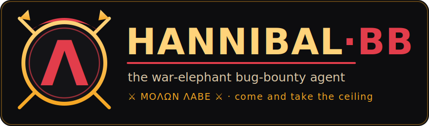

<p align="center">
  
</p>

<p align="center">
  <b>HannibalBB</b> — an autonomous, provider-agnostic bug-bounty agent in your terminal.<br>
  <i>Methodology · deep bug-class knowledge · a self-learning CVE arsenal · aim for the highest severity.</i>
</p>

<p align="center">
  
  
  
  
</p>

<p align="center">
  
</p>

---

## ⚡ Quick start

```bash
git clone https://github.com/<you>/hannibal-bb.git
cd hannibal-bb
./install.sh          # installs deps + the `hannibal` command (no sudo)
hannibal              # launch the agent interface
```

No installer? Run it straight from the repo:

```bash
pip install -r requirements.txt
./hannibal            # or:  python3 hannibal.py
```

That's it — type `hannibal`, and you're in the interface.

---

## 🧠 What it is

HannibalBB is a terminal agent for **authorized** security testing. It ships with:

- **Instructions** — a battle-tested system prompt (authorization-first, prove-don't-guess, chain-to-ceiling).
- **A 0→Hero methodology** — `recon → surface map → hunt by class → chain → validate → report`.
- **Bug Knowledge Cards** — per-class playbooks (spot / exploit / bypass / chain / severity ceiling).
- **A dynamic CVE arsenal** — pulls fresh CVEs, classifies them, and grows its own knowledge.
- **Tools** — executable functions (log brute-force analysis, HTTP recon, knowledge search, memory).
- **Memory** — short-term (conversation) + long-term (persisted facts).
- **Any AI** — talk to Claude, GPT, DeepSeek, a local model… via `API key + endpoint` (`/models`).

> ⚠️ **Use only on assets you are authorized to test.** HannibalBB is an educational / authorized-testing
> assistant. You are responsible for staying in scope and following the law.

---

## 🎮 Commands

| command | what it does |
|---|---|
| *(type a message)* | talk to HannibalBB |
| `/help` | list all commands |
| `/models` | list AIs · `/models add` to add one (key + endpoint) · `/models use <name>` |
| `/model <name>` | quick-switch the active AI |
| `/skills` | HannibalBB's skills |
| `/knowledge` · `/card <name>` | list / print a Bug Knowledge Card (e.g. `/card ssrf`) |
| `/arsenal` · `/learn` | arsenal status · run the live CVE self-learning loop |
| `/analyze <logfile>` | run the brute-force log-analysis **tool** |
| `/fingerprint <url>` | run the HTTP security-header recon **tool** |
| `/mission <1\|2\|3>` | load + run a demo mission |
| `/memory` · `/remember <fact>` | long-term memory |
| `/clear` · `/quit` | reset conversation · exit |

When running interactively, press **Tab** for command autocomplete.

---

## 🔌 Connect any AI

HannibalBB speaks the **OpenAI-compatible** chat API, so it works with almost any provider.

```text
/models add
  name:      groq
  base_url:  https://api.groq.com/openai/v1
  model:     llama-3.3-70b-versatile
  API key:   <your key>
```

Built-in profiles: `claude` (Anthropic), `openai`, `deepseek`. The default profile
`claude-code` needs **no key** if you have the local `claude` CLI installed — otherwise just
add any provider above. Keys live in a git-ignored `config/` file or in environment variables.

---

## 🗺️ Architecture

```
you ─▶ hannibal (REPL)
        ├─ system prompt   ← core/identity + methodology + operating protocol
        ├─ RAG             ← knowledge/*.md Bug Cards (retrieved per message)
        ├─ long memory     ← memory/hannibal_memory.json
        ├─ tools           ← analyze_auth_log · http_fingerprint · search_knowledge · remember
        ├─ arsenal loop    ← arsenal/learn_cve.py  (live CVEs → classify → cards)
        └─ provider        ← any OpenAI-compatible AI (/models)
```

More in [`docs/ARCHITECTURE.md`](docs/ARCHITECTURE.md), [`docs/MCP.md`](docs/MCP.md),
[`docs/AUTH.md`](docs/AUTH.md).

---

## 📁 Layout

```
hannibal.py            the agent (REPL, providers, RAG, memory, tools)
core/                  identity (system prompt) · methodology · operating protocol
knowledge/             Bug Knowledge Cards (idor, ssrf, xss, ssti, …)
arsenal/               dynamic CVE self-learning (feeds.yaml + learn_cve.py)
missions/              3 demo missions + a sample auth.log
connectors/            Discord / Teams / GitHub webhooks (secrets via env)
docs/                  architecture · MCP · auth
```

---

## 🤝 Contributing

Add a Bug Knowledge Card under `knowledge/` (follow the schema in `knowledge/_TAXONOMY.md`),
or extend the arsenal feeds. PRs welcome.

## 📜 License

MIT — see [LICENSE](LICENSE). For authorized security testing and education only.
